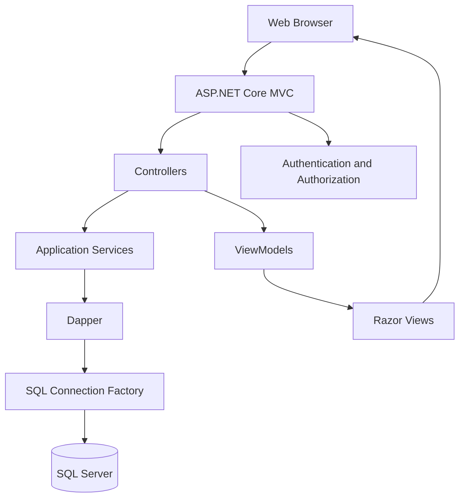
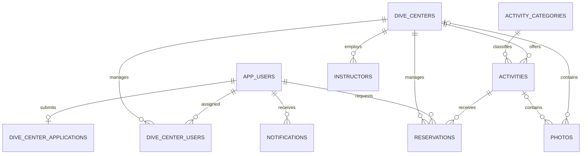
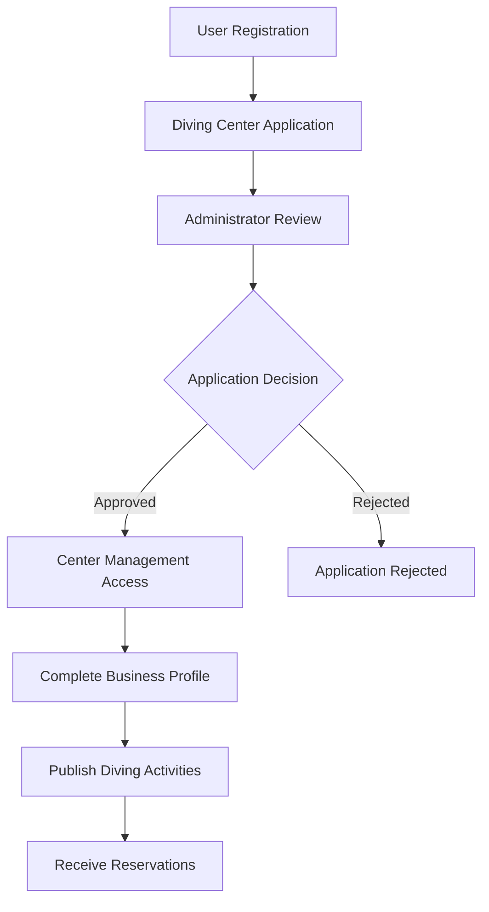
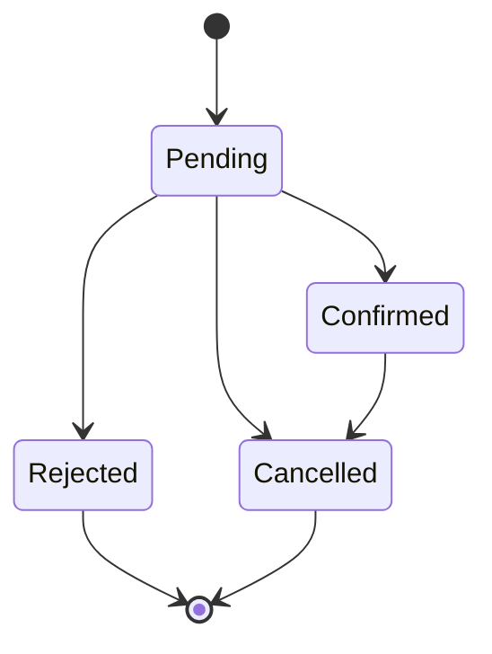

# Scuba Diving Marketplace


## Overview

Scuba Diving Marketplace is a full-stack web application designed to connect scuba divers with diving centers, professional instructors, diving courses and recreational diving experiences.

The platform provides a centralized digital marketplace where customers can discover diving activities and submit reservation requests, while diving center operators manage their business profiles, activity listings, instructors, photo galleries and reservations.

Administrators oversee marketplace operations, manage users and review diving center applications.

Developed with practical knowledge of scuba diving operations and tourism management, the project translates real-world business requirements into a structured, role-based software solution.

## Key Features

### Public Marketplace

- Scuba diving activity discovery
- Diving center directory
- Advanced search and filtering
- Country and city-based discovery
- Activity category and price range filtering
- Diving center and instructor profiles
- Activity details and photo galleries
- Map-based location information
- Responsive user interface

### Customer Portal

- User registration and authentication
- Personal profile management
- Activity reservation requests
- Participant selection
- Reservation history and status tracking
- Reservation cancellation
- Email, phone and WhatsApp contact preferences
- In-app notifications

### Diving Center Management

- Diving center application and approval workflow
- Business profile management
- Instructor management
- Diving activity and course management
- Activity pricing and currency configuration
- Participant capacity management
- Multiple image uploads
- Photo galleries and cover image selection
- Incoming reservation management
- Reservation confirmation and rejection
- Operational dashboard
- Reservation revenue reporting

### Administration

- Centralized administration dashboard
- User and role management
- Diving center application review
- Application approval and rejection
- Diving center ownership assignment
- Activity category management
- User account activation and deactivation
- Diving center listing management
- Marketplace-wide reservation revenue reporting
- Administrative notifications

## Technology Stack

| Category | Technology |
|---|---|
| Programming Language | C# |
| Runtime | .NET 10 |
| Web Framework | ASP.NET Core MVC |
| Presentation | Razor Views |
| Frontend | HTML5, CSS3, JavaScript |
| UI Framework | Bootstrap |
| Database | Microsoft SQL Server |
| Data Access | Dapper 2.1.89 |
| Database Provider | Microsoft.Data.SqlClient 7.1.2 |
| Authentication | ASP.NET Core Cookie Authentication |
| Authorization | Role-Based Access Control |
| Password Management | ASP.NET Core PasswordHasher |
| Dependency Management | NuGet |
| Testing | PowerShell Smoke Tests |
| Version Control | Git and GitHub |

## Application Architecture

The application follows a layered MVC architecture that separates presentation, request handling, business logic and relational database access.



### Architectural Components

| Component | Responsibility |
|---|---|
| Controllers | HTTP request handling and application workflows |
| Services | Business logic and database operations |
| Models | Application entities and database representations |
| ViewModels | Input validation and presentation-specific data |
| Views | Server-rendered user interfaces |
| Data | Database connection management |
| Database | SQL schema and initialization scripts |
| Tests | Automated application workflow verification |
| wwwroot | Stylesheets, JavaScript and frontend assets |

## Project Structure

```text
Scuba-Diving-Marketplace/
│
├── Controllers/
├── Data/
│   └── SqlConnectionFactory.cs
│
├── Database/
│   ├── 001_CreateDatabaseAndSchema.sql
│   ├── 002_SeedData.sql
│   └── 003_PromoteFirstAdmin.sql
│
├── Models/
├── Services/
├── ViewModels/
├── Views/
│
├── Tests/
│   ├── SmokeTest.ps1
│   ├── PhotoSmokeTest.ps1
│   ├── NotificationSmokeTest.ps1
│   ├── AdminNotificationUiSmokeTest.ps1
│   ├── ProfileManagementSmokeTest.ps1
│   ├── LocationContactSmokeTest.ps1
│   └── ReservationRevenueSmokeTest.ps1
│
├── Properties/
├── wwwroot/
│   ├── css/
│   ├── js/
│   └── lib/
│
├── Program.cs
├── DiveMarketplace.csproj
├── appsettings.json
├── appsettings.Development.json
├── global.json
├── .gitignore
└── README.md
```

## Database Architecture

The application uses a relational SQL Server database consisting of ten core tables.

| Table | Description |
|---|---|
| AppUsers | User accounts and authorization roles |
| DiveCenters | Diving center business profiles |
| DiveCenterUsers | Diving center ownership and access relationships |
| DiveCenterApplications | Diving center registration applications |
| ActivityCategories | Marketplace activity classifications |
| Activities | Diving experiences, courses and activity listings |
| Instructors | Professional instructor profiles |
| Reservations | Customer reservation records |
| Photos | Image content and gallery metadata |
| Notifications | User notifications and application events |

### Entity Relationships



Each photo belongs to either a diving center or an activity, enforced through a database check constraint.

### Database Integrity

The database implements:

- Primary keys and foreign keys
- Composite foreign keys
- Unique constraints
- Check constraints
- Default values
- Filtered unique indexes
- Reservation lookup indexes
- Referential integrity rules

## Business Workflows

### Diving Center Onboarding



### Reservation Lifecycle



Reservation prices are captured at the time of booking, preserving historical pricing information even when activity prices change.

### Multi-Currency Support

The marketplace supports:

| Currency | Description |
|---|---|
| TRY | Turkish Lira |
| USD | US Dollar |
| EUR | Euro |
| GBP | British Pound |

Revenue reporting separates currencies and reservation statuses without combining unrelated currency amounts.

Reported revenue represents reservation values rather than collected online payments.

## Photo Management

Uploaded images are stored directly in SQL Server using binary data, allowing image content and related application records to be maintained within the same database.

Supported functionality includes:

- Multiple image uploads
- JPEG, PNG and WebP formats
- Maximum file size of 5 MB per image
- Image content validation
- Diving center and activity galleries
- Cover image selection
- External image URLs
- Image visibility and access restrictions
- Legacy local-image migration

## Authentication and Security

The application implements multiple security controls:

- Cookie-based authentication
- Password hashing
- Role-based authorization
- Resource ownership verification
- Parameterized SQL queries
- Cross-Site Request Forgery protection
- Server-side input validation
- Image upload validation
- Active account verification
- Authentication cookie invalidation following role changes
- HTTP-only authentication cookies
- Secure authentication cookies outside development
- Database-level integrity constraints

These controls provide a foundation for application security. A production deployment requires additional infrastructure configuration, security review and operational monitoring.

## Getting Started

### Prerequisites

- .NET 10 SDK
- Microsoft SQL Server or SQL Server Express
- SQL Server Management Studio or sqlcmd
- PowerShell
- Git
- Visual Studio or Visual Studio Code

### 1. Clone the Repository

```powershell
git clone https://github.com/hakanberat/Scuba-Diving-Marketplace.git
cd Scuba-Diving-Marketplace
```

### 2. Database Configuration

The default local configuration uses SQL Server Express and Windows Authentication.

The connection string is defined in `appsettings.json`.

```json
{
  "ConnectionStrings": {
    "DefaultConnection": "Server=localhost\\SQLEXPRESS;Database=DiveMarketplaceDb;Trusted_Connection=True;TrustServerCertificate=True;"
  }
}
```

Update the connection string if your SQL Server instance uses a different configuration.

Production credentials should be provided through environment variables or an appropriate secret management system rather than committed to source control.

### 3. Database Initialization

The database is initialized through three consolidated SQL scripts.

| Script | Purpose |
|---|---|
| 001_CreateDatabaseAndSchema.sql | Creates the database, tables, relationships and indexes |
| 002_SeedData.sql | Inserts standard activity categories |
| 003_PromoteFirstAdmin.sql | Promotes an existing registered user to administrator |

Execute the first two scripts in the following order:

```powershell
sqlcmd -S 'localhost\SQLEXPRESS' -d master -E -C -I -b -i '.\Database\001_CreateDatabaseAndSchema.sql'

if ($LASTEXITCODE -ne 0) {
    throw 'Database initialization failed.'
}

sqlcmd -S 'localhost\SQLEXPRESS' -d DiveMarketplaceDb -E -C -I -b -i '.\Database\002_SeedData.sql'

if ($LASTEXITCODE -ne 0) {
    throw 'Seed data initialization failed.'
}
```

The scripts can also be executed using SQL Server Management Studio.

The seed script contains fourteen standard diving activity categories.

No predefined customer accounts, diving center listings, reservations, uploaded customer images or administrator credentials are included in the initialization scripts.

### 4. Restore and Build

```powershell
dotnet restore
dotnet build
```

### 5. Run the Application

```powershell
dotnet run --project .\DiveMarketplace.csproj --launch-profile http
```

Open the application in your browser:

http://localhost:5258

For HTTPS development:

```powershell
dotnet dev-certs https --trust
dotnet run --project .\DiveMarketplace.csproj --launch-profile https
```

https://localhost:7135

### 6. Administrator Initialization

Register a user account through the application.

Open the following SQL script in SQL Server Management Studio:

```text
Database/003_PromoteFirstAdmin.sql
```

Replace the email placeholder with the email address of the registered account.

Execute the script manually, then sign out and sign in again.

The administrator promotion script is intentionally excluded from automated database initialization.

## Automated Testing

The repository includes seven PowerShell-based smoke test suites that exercise application workflows through HTTP requests and database verification.

| Test Suite | Coverage |
|---|---|
| SmokeTest | Registration, authentication, authorization, activity management and reservations |
| PhotoSmokeTest | Image uploads, validation, galleries and access restrictions |
| NotificationSmokeTest | Application and reservation notifications |
| AdminNotificationUiSmokeTest | Administrator notification interface |
| ProfileManagementSmokeTest | User account and profile management |
| LocationContactSmokeTest | Location information and reservation contact preferences |
| ReservationRevenueSmokeTest | Revenue reporting, currencies and authorization |

### Running Tests

The current smoke tests are configured to connect directly to `localhost\SQLEXPRESS` and `DiveMarketplaceDb`.

Use an isolated, disposable SQL Server environment with matching configuration.

The main smoke test requires additional test fixtures, including a diving center with ID 1 and an activity named `Discover Scuba Diving`. These fixtures are not included in the standard database seed script.

After preparing the test environment and starting the application:

```powershell
.\Tests\SmokeTest.ps1 -BaseUrl 'http://localhost:5258'
```

**Do not run these tests against a production or operational database.**

The tests create and modify database records, and some historical test records may remain after cleanup.

## Engineering Highlights

- Layered MVC application structure
- Dependency injection and service-oriented design
- Asynchronous database operations
- Parameterized SQL through Dapper
- Transaction-based database operations
- Role-based and resource-level authorization
- Database-enforced business constraints
- Historical reservation price preservation
- Multi-currency revenue reporting
- SQL Server binary image storage
- Automated end-to-end workflow verification
- Reproducible SQL initialization scripts

## Development Roadmap

- Clean database installation verification
- Configurable and isolated test database connections
- Automated test fixture initialization
- xUnit unit and integration tests
- Docker containerization
- Docker Compose orchestration
- GitHub Actions CI/CD
- Production deployment configuration
- Structured logging and monitoring
- Online payment integration

## Project Status

The marketplace application, relational database schema, role-based management interfaces and smoke test suites are implemented.

Deployment preparation, isolated test execution and production infrastructure improvements are ongoing.

## Author

**Hakan Berat Demircan**

Software Developer | Information Technology | PhD in Tourism Management

This project combines software engineering, information technology and practical experience in scuba diving operations to address real-world marketplace and business management requirements.

- GitHub: [github.com/hakanberat](https://github.com/hakanberat)
- Portfolio: [hakanberat.github.io](https://hakanberat.github.io)

---

**Scuba Diving Marketplace**

Connecting diving experiences with digital business management.
